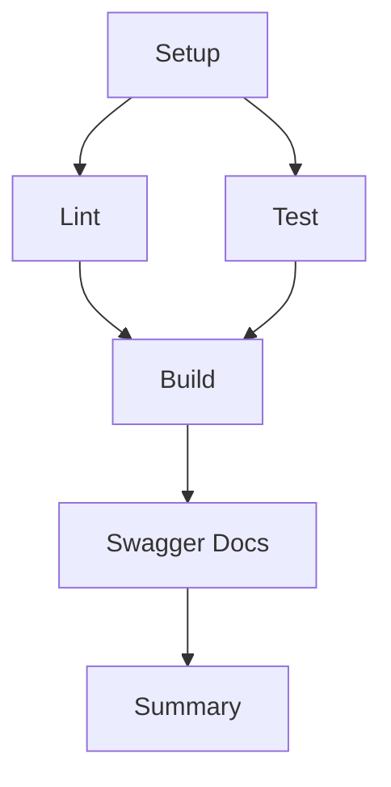

# 🚀 Pipeline CI/CD - UniServices

## 📋 Descripción General

Este documento describe el pipeline de CI/CD implementado con GitHub Actions para el monorepo de UniServices. El pipeline se ejecuta automáticamente en cada push o pull request a las ramas principales.

## 🔄 Flujo del Pipeline

El pipeline está dividido en 6 jobs principales que se ejecutan en el siguiente orden:



## 📦 Jobs del Pipeline

### 1. Setup (📦 Setup & Install Dependencies)

**Propósito:** Instalar todas las dependencias del monorepo y cachearlas para los siguientes jobs.

**Acciones:**

- Checkout del código
- Configuración de pnpm y Node.js
- Instalación de dependencias con `pnpm install --frozen-lockfile`
- Cache de `node_modules` y store de pnpm

**Duración estimada:** ~2-3 minutos

---

### 2. Lint (🔍 Lint & Format Check)

**Propósito:** Verificar la calidad del código usando ESLint y Prettier.

**Acciones:**

- Restaura las dependencias instaladas
- Ejecuta `pnpm run lint` en todos los servicios
- Ejecuta `pnpm run format` para verificar el formato del código

**Comandos ejecutados:**

```bash
pnpm run lint    # ESLint en todos los servicios
pnpm run format  # Prettier check
```

**Duración estimada:** ~1-2 minutos

**Falla si:** Hay errores de linting (continue-on-error: false para lint)

---

### 3. Test (🧪 Run Tests)

**Propósito:** Ejecutar pruebas unitarias y generar reportes de cobertura.

**Acciones:**

- Restaura las dependencias instaladas
- Ejecuta `pnpm run test:cov` en todos los servicios
- Genera reportes de cobertura en formato LCOV
- Sube los reportes como artifacts

**Comandos ejecutados:**

```bash
pnpm run test:cov
```

**Artifacts generados:**

- `coverage-reports` (retención: 30 días)
  - Incluye reportes de cobertura de todos los servicios
  - Formato: HTML + LCOV

**Duración estimada:** ~3-5 minutos

**Falla si:** Alguna prueba falla

---

### 4. Build (🏗️ Build Application)

**Propósito:** Compilar todos los servicios del monorepo.

**Acciones:**

- Restaura las dependencias instaladas
- Ejecuta `pnpm run build` usando Turborepo
- Compila todos los servicios en paralelo
- Sube los builds como artifacts

**Comandos ejecutados:**

```bash
pnpm run build
```

**Servicios compilados:**

- `apigatewayUniversidad` → `dist/`
- `Auth-back-service` → `dist/`
- `tramites-back` → `dist/`
- `ui-tramites` → `build/` o `.svelte-kit/`
- `uniauth` → `dist/`

**Artifacts generados:**

- `build-artifacts` (retención: 7 días)
  - Contiene todos los directorios `dist/` y `build/`

**Duración estimada:** ~3-5 minutos

**Falla si:** La compilación de algún servicio falla

---

### 5. Swagger Docs (📚 Generate Swagger Documentation)

**Propósito:** Generar documentación automática de la API usando Swagger/OpenAPI.

**Acciones:**

- Descarga los artifacts del build
- Genera documentación Swagger del API Gateway
- Crea una página HTML de índice
- Sube la documentación como artifact

**Estructura generada:**

```
docs/swagger/
├── api-gateway.json    # Especificación OpenAPI 3.0
└── index.html          # Página de índice
```

**Artifacts generados:**

- `swagger-documentation` (retención: 90 días)
  - Documentación OpenAPI en formato JSON
  - Página HTML de índice

**Duración estimada:** ~1-2 minutos

**Características:**

- ✅ Generación automática desde código
- ✅ Formato OpenAPI 3.0
- ✅ Incluye endpoints, schemas y authentication
- ✅ Descargable como JSON

---

### 6. Summary (📊 Pipeline Summary)

**Propósito:** Generar un resumen final del pipeline.

**Acciones:**

- Recopila el estado de todos los jobs
- Genera un resumen en el GitHub Action Summary
- Muestra información del commit, branch y autor

**Se ejecuta:** Siempre, incluso si algún job anterior falla

---

## 🎯 Triggers del Pipeline

El pipeline se ejecuta automáticamente en los siguientes eventos:

### Push

```yaml
on:
  push:
    branches:
      - master
      - main
      - develop
```

### Pull Request

```yaml
on:
  pull_request:
    branches:
      - master
      - main
      - develop
```

## ⚙️ Configuración

### Variables de Entorno

```yaml
NODE_VERSION: "18" # Versión de Node.js
PNPM_VERSION: "10.11.0" # Versión de pnpm
```

### Concurrency

El pipeline implementa concurrency para cancelar ejecuciones anteriores:

```yaml
concurrency:
  group: ${{ github.workflow }}-${{ github.ref }}
  cancel-in-progress: true
```

## 📊 Artifacts Generados

| Artifact                | Retención | Contenido                                |
| ----------------------- | --------- | ---------------------------------------- |
| `coverage-reports`      | 30 días   | Reportes de cobertura de tests           |
| `build-artifacts`       | 7 días    | Builds compilados de todos los servicios |
| `swagger-documentation` | 90 días   | Documentación OpenAPI/Swagger            |

## 🔧 Mantenimiento

### Actualizar versión de Node.js

Edita la variable de entorno en `.github/workflows/ci.yaml`:

```yaml
env:
  NODE_VERSION: "20" # Nueva versión
```

### Actualizar versión de pnpm

Edita la variable de entorno en `.github/workflows/ci.yaml`:

```yaml
env:
  PNPM_VERSION: "10.12.0" # Nueva versión
```

### Agregar nuevos servicios

Los nuevos servicios se detectan automáticamente si tienen los siguientes scripts en su `package.json`:

```json
{
  "scripts": {
    "build": "...",
    "lint": "...",
    "format": "...",
    "test": "...",
    "test:cov": "..."
  }
}
```

### Agregar validaciones adicionales

Para agregar nuevos jobs, añade un nuevo job en `.github/workflows/ci.yaml`:

```yaml
new-job:
  name: 🔍 Nueva Validación
  runs-on: ubuntu-latest
  needs: setup # Dependencias
  steps:
    - name: Checkout
      uses: actions/checkout@v4
    # ... tus pasos
```

## 🐛 Troubleshooting

### El pipeline falla en el step de tests

**Problema:** Tests fallan o no se encuentran.

**Solución:**

1. Verifica que todos los servicios tengan el script `test:cov` en su `package.json`
2. Ejecuta localmente: `pnpm run test:cov`
3. Revisa los logs del job `test` en GitHub Actions

### El build falla

**Problema:** La compilación falla en algún servicio.

**Solución:**

1. Ejecuta localmente: `pnpm run build`
2. Verifica que todas las dependencias estén instaladas
3. Revisa los logs del job `build` en GitHub Actions

### Falla la generación de Swagger

**Problema:** No se genera la documentación Swagger.

**Solución:**

1. Verifica que el API Gateway tenga `@nestjs/swagger` instalado
2. Verifica que el build del API Gateway se haya completado
3. El script de generación tiene un fallback, no debería fallar el pipeline

### Cache de dependencias no funciona

**Problema:** Las dependencias se reinstalan en cada ejecución.

**Solución:**

1. Verifica que el archivo `pnpm-lock.yaml` esté commiteado
2. Revisa que la versión de pnpm sea la correcta
3. GitHub Actions puede limpiar el cache automáticamente después de 7 días

## 📈 Métricas y Reporting

### Ver reportes de cobertura

1. Ve a la pestaña "Actions" del repositorio
2. Selecciona la ejecución del workflow
3. Descarga el artifact `coverage-reports`
4. Abre el archivo `index.html` en tu navegador

### Ver documentación Swagger

1. Ve a la pestaña "Actions" del repositorio
2. Selecciona la ejecución del workflow
3. Descarga el artifact `swagger-documentation`
4. Abre el archivo `index.html` en tu navegador

## 🚀 Mejoras Futuras

- [ ] Integración con Codecov o Coveralls
- [ ] Deployment automático a staging/producción
- [ ] Notificaciones a Slack/Discord
- [ ] Análisis de seguridad con Snyk o Dependabot
- [ ] Performance testing
- [ ] E2E testing con Playwright o Cypress
- [ ] Docker builds y push a registry
- [ ] Semantic versioning automático

## 📚 Referencias

- [GitHub Actions Documentation](https://docs.github.com/en/actions)
- [Turborepo Documentation](https://turbo.build/repo/docs)
- [pnpm Documentation](https://pnpm.io/)
- [NestJS Swagger](https://docs.nestjs.com/openapi/introduction)

---

**Última actualización:** Octubre 9, 2025  
**Mantenedor:** @Ferdinan7
